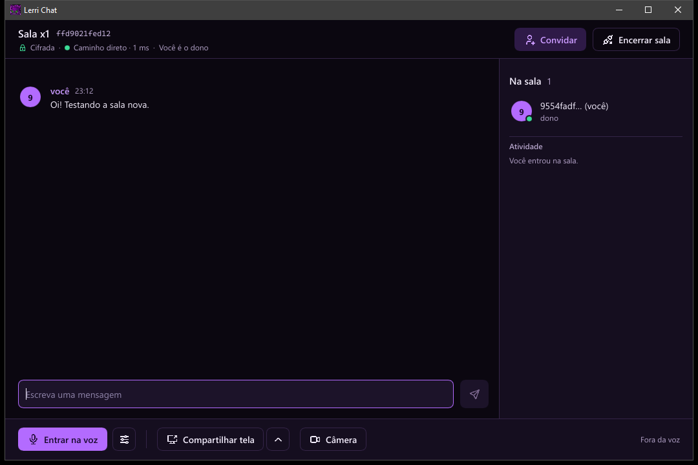
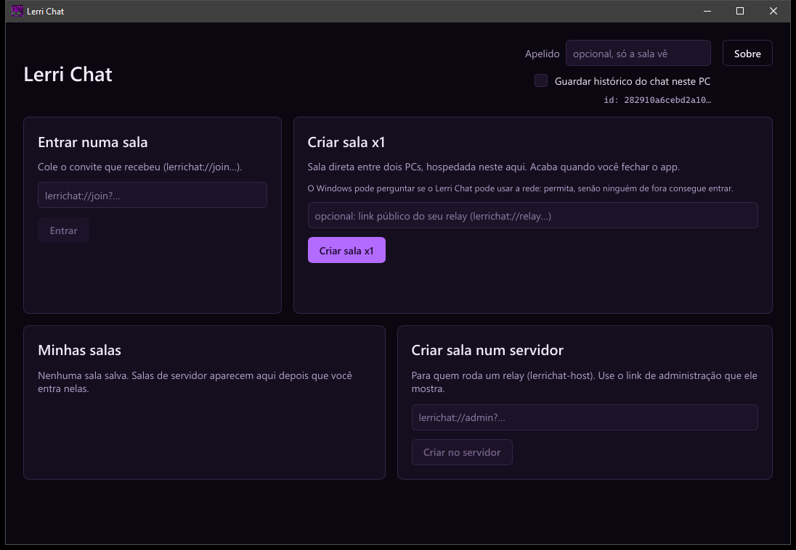
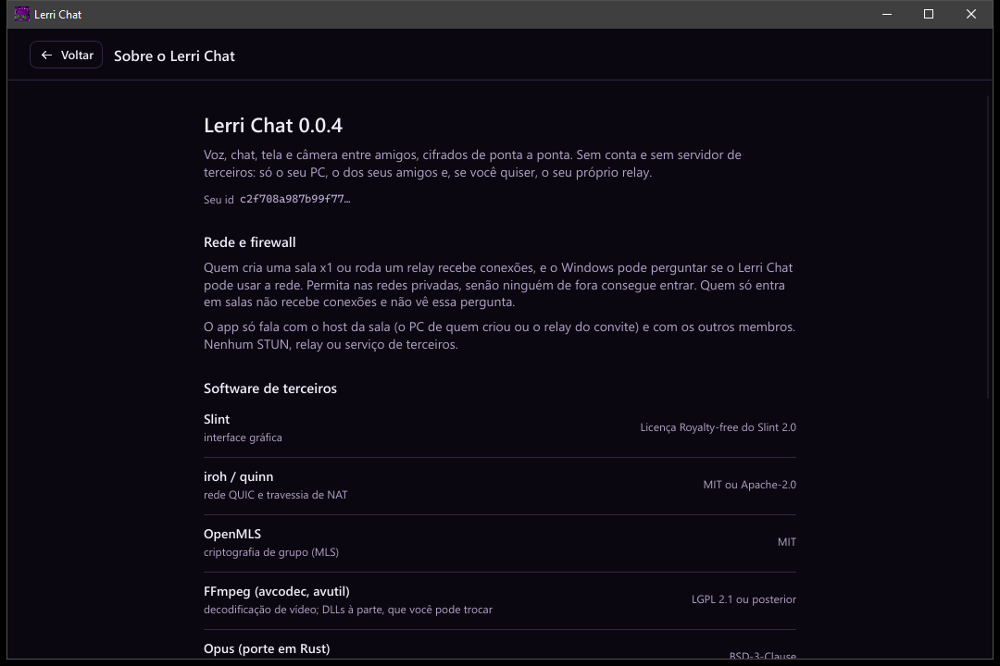

<p align="center">
  
</p>

<h1 align="center">Lerri Chat</h1>

<p align="center">
  <b>Voz, chat, tela e câmera entre amigos. Cifrado de ponta a ponta, sem conta, sem nuvem de ninguém.</b><br>
  Um único <code>.exe</code> de 23 MB que abre em menos de 0,1 s e fica em 22 MB de RAM parado.
</p>

<p align="center">
  <a href="https://github.com/L3RR1/Lerri-Chat/actions/workflows/ci.yml"></a>
  
  
  
</p>

<p align="center">
  
</p>

---

## Por quê

O Discord é pesado, exige conta, guarda tudo e lê o que quiser. O Lerri Chat é o oposto:

- 🔒 **O servidor é cego.** Mensagens, voz, tela e câmera saem cifradas do seu PC e só abrem no PC de quem está na sala. Quem hospeda repassa bytes que não consegue ler, e não consegue se infiltrar no grupo.
- 👤 **Anônimo de verdade.** Sua identidade é um par de chaves criado no seu PC. Sem e-mail, sem telefone, sem nome.
- 🎟️ **Só entra quem é convidado.** Convites de uso único, válidos por 24 h, com link e QR. Sem lista pública, sem busca.
- 🏠 **Você hospeda.** Direto entre dois PCs, ou num servidor seu (VPS, Proxmox de casa). Nenhum STUN, relay ou serviço de terceiros.
- ⚡ **Leve como deve ser.** Interface nativa (sem navegador embutido), captura e codificação de vídeo na GPU, decodificação só do que você está assistindo.

## O que tem

| | |
|---|---|
| 💬 **Chat em grupo** | Cifrado com MLS (o protocolo de grupo da IETF). Quem é removido não lê mais nada daí em diante. Histórico local opcional. |
| 🎙️ **Voz** | Opus, cancelamento de eco (AEC3), supressão de ruído (com modo forte via RNNoise), ganho automático. Transmite quando você fala ou só segurando uma tecla (push-to-talk global, vale com o jogo em foco, qualquer tecla ou botão do mouse). Escolha de microfone e saída. Ondas roxas saindo de quem está falando. |
| 🖥️ **Tela** | A tela inteira ou uma janela só. Captura e codificação na GPU (HEVC, H.264 ou AV1 conforme a placa; sem encoder na placa, H.264 por software em 720p30), codec negociado pelo que todos conseguem decodificar, bitrate adaptativo. Rede ruim desce numa escada em vez de travar: com AV1, primeiro metade do fps (SVC), depois uma versão 360p (simulcast). 1080p60 gastando 0,1% da CPU. Até 4 telas e câmeras assistidas ao mesmo tempo, em grade. |
| 📷 **Câmera** | 720p pelo mesmo caminho da tela. Dá para compartilhar tela e câmera juntas, e assistir às duas. |
| 🛡️ **Gestão** | O dono convida e remove; remover troca a chave do grupo na hora. Aviso de quem entrou, com o início da chave pública. Latência até cada pessoa ao lado do nome. |

## Dois jeitos de hospedar

| Modo | Como funciona | Quando usar |
|------|---------------|-------------|
| **x1 (direto)** | Quem cria a sala vira o host; o outro conecta direto nele (IPv6, porta mapeada pelo roteador ou hole punching pelo seu relay) | 2 pessoas, latência mínima, zero infraestrutura |
| **Servidor** | O `lerrichat-host` roda numa máquina sua e repassa para todos, sem decifrar nada | 3 ou mais pessoas, sala que continua de pé quando alguém sai |

## Números

Medidos num Ryzen 5 5600 + RX 6700 XT, build release, processo real:

| | |
|---|---|
| Tamanho do `.exe` | **23,4 MiB** (meta: < 25) |
| Janela aberta | **42–91 ms** (meta: < 1,5 s) |
| RAM parado | **22 MB** na tela inicial, **37 MB** hospedando uma sala (meta: < 80) |
| Voz, os dois lados falando | **0,26%** da CPU, 24 MB |
| Transmitindo a tela a 58 fps | **0,09%** da CPU |
| Tela + câmera ao mesmo tempo | **0,17%** da CPU |

## Usar

**Baixar:** pegue o `LerriChat-…-windows-x64.zip` em [Releases](https://github.com/L3RR1/Lerri-Chat/releases), extraia a pasta e abra o `lerrichat.exe`. Não instala nada.

**Primeira vez:** o `.exe` não é assinado, então o Windows mostra "O Windows protegeu o computador". Clique em **Mais informações** → **Executar assim mesmo**. Se for criar sala x1, permita o acesso à rede quando o Windows perguntar.

Abra o `lerrichat.exe`:

- **Entrar numa sala:** cole o convite (`lerrichat://join?…`). Depois da primeira execução, clicar num convite já abre o app.
- **Criar sala x1:** cria a sala neste PC e mostra o convite (link + QR).
- **Criar sala num servidor:** cole o link de administração que o `lerrichat-host` mostra.

Na sala, a barra de baixo controla voz, tela e câmera. O botão de ajustes ao lado da voz abre **Voz e áudio** (microfone, saída, push-to-talk e supressão forte); a setinha ao lado de **Compartilhar tela** escolhe a tela ou uma janela. Quem compartilha ganha um botão **Assistir** (ou **Câmera**) na lista de membros; dá para assistir a até 4 ao mesmo tempo, e cada vídeo tem o seu **Fechar**.

<p align="center">
  
  
</p>

Para **assistir** telas e câmeras, o app usa as DLLs do FFmpeg da pasta `ffmpeg` ao lado do `.exe` (`avcodec-63.dll` e `avutil-61.dll`, LGPL). O zip já vem com elas, num build mínimo só com o decode de H.264, HEVC e AV1 pela GPU ([`scripts/ffmpeg-min.sh`](scripts/ffmpeg-min.sh)). Sem elas, todo o resto funciona e a sala avisa. Compartilhar não precisa delas.

### Servidor (Proxmox, VPS)

```sh
lerrichat-host --public <IP ou domínio>    # mostra o link de administração e o link público
```

O relay usa a porta `P` em UDP (salas) e TCP (ponto de encontro), e `P+1` em UDP (descoberta de endereço). Atrás de um roteador, abra as três.

### Linha de comando

```sh
lerrichat --x1                                # cria sala x1; convite no terminal
lerrichat --x1 --via "lerrichat://relay?…"    # x1 com hole punching pelo seu relay
lerrichat --cli --join "lerrichat://join?…"   # entra sem abrir a janela
lerrichat --create "lerrichat://admin?…"      # cria sala no servidor
lerrichat --open <id>                         # volta a uma sala salva
lerrichat --register                          # faz os links lerrichat:// abrirem o app
```

Dentro da sala: `convite`, `membros`, `rota`, `/voz`, `/mudo`, `/desmutar`, `/sair-da-voz`, `/tela`, `/parar-tela`, `/camera`, `/parar-camera`, `/assistir PREFIXO`, `/ver-camera PREFIXO`, `/parar-de-assistir`, `sair`.

## Compilar

Requer Rust stable e, no Windows, as Build Tools do Visual Studio (MSVC + Windows SDK).

```sh
cargo test --workspace --exclude spike-video --exclude spike-p2p
cargo build --release -p lerrichat          # target/release/lerrichat.exe
cargo build --release -p lerrichat-host     # relay headless (Linux)
bash scripts/ffmpeg-min.sh ffmpeg-min       # DLLs do FFmpeg (Linux com mingw-w64)
```

A CI monta o zip a cada push; uma tag `v*` publica a Release.

## Como funciona por dentro

| Camada | Escolha |
|--------|---------|
| Rede | QUIC com [iroh](https://github.com/n0-computer/iroh) (só com o relay do usuário), IPv6, PCP/NAT-PMP/UPnP, hole punching |
| Criptografia | [OpenMLS](https://github.com/openmls/openmls) para o grupo; SFrame com chave por remetente para voz e vídeo; identidade Ed25519 cifrada com DPAPI |
| Mídia | WASAPI + Opus + AEC3; captura WGC/DXGI e encoders de hardware do Media Foundation; decode D3D11VA |
| Interface | [Slint](https://slint.dev) com renderer software (sem driver gráfico carregado); vídeo em janela-filha D3D11, sem cópia para a CPU |

O projeto é guiado por especificação: primeiro a spec, depois o código.

1. [`SPEC-00-visao.md`](SPEC-00-visao.md): requisitos e princípios
2. [`SPEC-01-arquitetura.md`](SPEC-01-arquitetura.md): stack e desenho técnico
3. [`SPEC-02-seguranca.md`](SPEC-02-seguranca.md): identidade, E2EE, convites, modelo de ameaça
4. [`SPEC-03-rede.md`](SPEC-03-rede.md): QUIC, NAT, CGNAT, x1 × servidor
5. [`SPEC-04-midia.md`](SPEC-04-midia.md): voz, tela e câmera
6. [`SPEC-05-design-system.md`](SPEC-05-design-system.md): identidade visual
7. [`SPEC-06-fases.md`](SPEC-06-fases.md): roadmap com critérios de aceite

## Estado

Fases 0 a 6 implementadas: fundação, salas e convites, chat E2EE, voz, tela, câmera e interface. Testado na mesma máquina e na mesma rede; falta o teste entre dois PCs em redes diferentes e no servidor. Depois da Fase 6 entraram push-to-talk, escolha de microfone e saída, compartilhar uma janela, simulcast da tela, latência por membro e o anel de "falando" em onda. Detalhes e pendências em [`SPEC-06`](SPEC-06-fases.md).

## Escopo de uso

Ferramenta de comunicação privada entre pessoas que trocam o convite por fora. Não há moderação central porque não há central: o dono de cada sala responde por quem convida.
